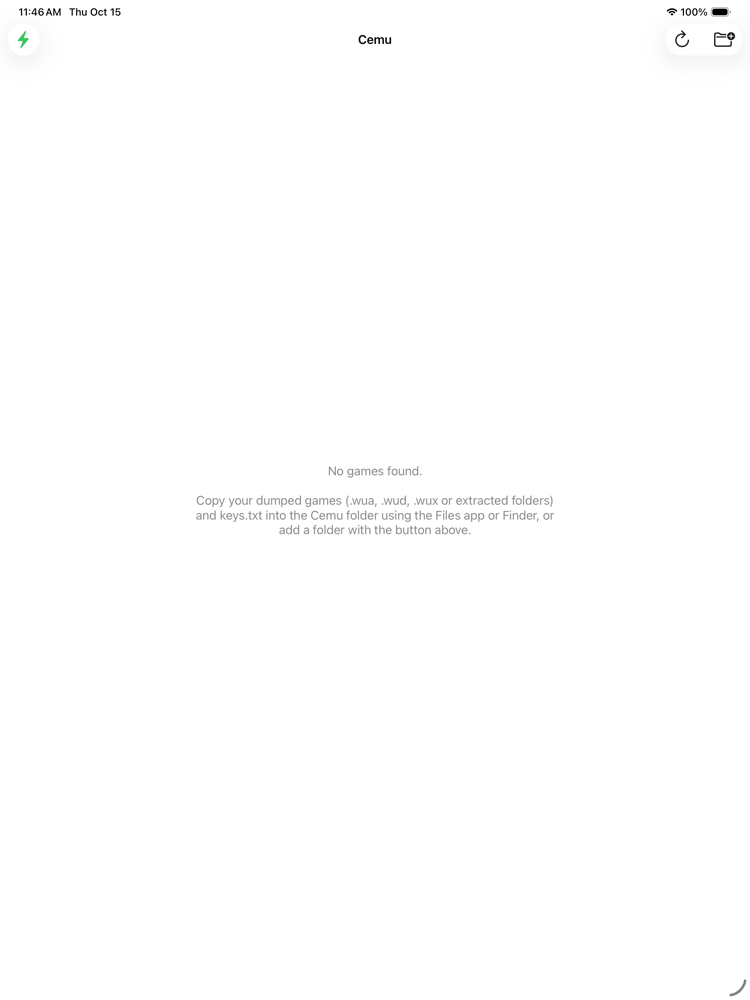

# Cemu for iPad

A native iPadOS port of [Cemu](https://github.com/cemu-project/Cemu), the Wii U emulator, built on Cemu's Metal renderer.

> [!WARNING]
> **Work in progress, not playable yet.** The app builds and runs, and homebrew titles boot partway in the iPad Simulator,
> but no game has been confirmed working on a real iPad yet. Expect crashes.

<p align="center"></p>

## What's in the port

| Area | iPad implementation |
| --- | --- |
| UI | Native UIKit frontend (`src/ios/`) replacing wxWidgets: game list, full screen emulation view, in-game menu |
| Graphics | Cemu's Metal backend, fed by a `CAMetalLayer`. Software BC texture decoding on GPUs without BC support |
| CPU | Cemu's AArch64 recompiler, using a dual-mapped JIT memory pool (see [JIT](#jit)). Interpreter fallback |
| Audio | New CoreAudio (RemoteIO) backend (cubeb's backend is macOS only) |
| Input | MFi / Xbox / PlayStation / Switch Pro controllers through SDL3, mapped to the GamePad automatically. On-screen controller via `GCVirtualController`. Touch goes to the GamePad touchscreen |
| Files | Cemu's folder is visible in the Files app and in Finder (`keys.txt`, `games/`, `mlc01/`, `settings.xml`, `log.txt`) |

Desktop builds are unaffected. All iPad specific code is behind `CEMU_IOS` / `BOOST_OS_IOS`.

## Status

- [x] Cemu core, Metal renderer and all dependencies build for arm64 iPadOS and the iOS Simulator
- [x] App starts, initializes the emulator, scans for games, enables JIT (Simulator)
- [x] Homebrew Unity title boots: modules load and link, the recompiler runs, CoreAudio starts, first draw calls are issued (Simulator)
- [ ] Rendering a first frame: the Simulator's GPU lacks cube-array textures, so further testing needs a real device or "Designed for iPad" on a Mac
- [ ] JIT on real iPads (StikDebug handshake implemented, untested on hardware)
- [ ] Settings UI, graphic pack management, launching a second game without restarting
- [ ] GamePad on a second screen (split view / external display), motion controls, hotkeys

## Requirements

- An iPad with Apple silicon (M1 or newer) on iPadOS 17 or newer
- A Mac with Xcode 26 or newer
- A **paid** Apple Developer account. Cemu reserves a contiguous 4 GB block for the Wii U address space, which needs the
  `extended-virtual-addressing` and `increased-memory-limit` entitlements
- [StikDebug](https://github.com/StikDebug/StikDebug) to enable JIT
- Your own Wii U game dumps and `keys.txt`. **No games or keys are provided here.**

## Building

Build instructions, the launch arguments used for testing and the JIT details are in **[src/ios/README.md](src/ios/README.md)**.
In short:

```sh
git clone --recursive https://github.com/jonasgunklach/CEMU-for-iPad.git
cd CEMU-for-iPad
brew install cmake ninja pkgconf autoconf automake libtool
export DEVELOPER_DIR=/Applications/Xcode.app/Contents/Developer

# dependencies for arm64 iPadOS
./dependencies/vcpkg/bootstrap-vcpkg.sh -disableMetrics
./dependencies/vcpkg/vcpkg install --triplet arm64-ios-cemu \
    --overlay-triplets=dependencies/vcpkg_triplets --overlay-ports=dependencies/vcpkg_overlay_ports \
    --x-install-root=../vcpkg_installed_ios

# Xcode project, then open it, pick the "CemuiOS" scheme and your iPad, and press Run
cmake -S . -B ../build-ios-xcode -G Xcode -DCMAKE_SYSTEM_NAME=iOS -DCMAKE_OSX_ARCHITECTURES=arm64 \
    -DVCPKG_INSTALLED_DIR=$PWD/../vcpkg_installed_ios -DVCPKG_MANIFEST_INSTALL=OFF \
    -DCEMU_IOS_DEVELOPMENT_TEAM=<your team id> -DCEMU_IOS_BUNDLE_ID=<your bundle id>
```

## JIT

iPadOS doesn't let apps create executable memory. Without JIT Cemu falls back to its interpreter, which is far too slow for
games. With a debugger attached, Cemu sets up a 512 MB code pool that is mapped twice: once writable for the recompiler and
once executable ([`JitMemory_iOS.cpp`](src/util/MemMapper/JitMemory_iOS.cpp)). On iPadOS 26+ devices with TXM, StikDebug
must also prepare the pool. Cemu requests this with the `brk #0xf00d` protocol of StikDebug's universal JIT script, and
StikDebug detaches afterwards.

In the app, tap the bolt in the game list and choose **Open StikDebug**. The bolt turns green once JIT is active.

## Credits and license

This is a fork of [Cemu](https://github.com/cemu-project/Cemu) by the Cemu project and contributors, including the Metal
renderer and the AArch64 recompiler. The original README is kept as [README.upstream.md](README.upstream.md).
The JIT approach follows the protocol documented by [StikJIT](https://github.com/StikDebug/StikJIT).

Licensed under the [Mozilla Public License 2.0](LICENSE.txt), like Cemu. This project is not affiliated with the Cemu
project or Nintendo. Wii U is a trademark of Nintendo.
